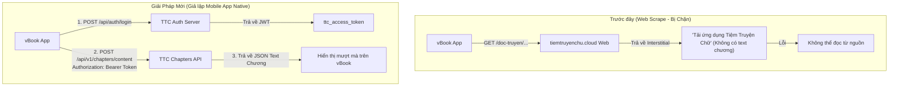

# Kế Hoạch Triển Khai: Tích Hợp API Mobile Native Cho Extension Tiệm Truyện Chữ

## 1. Goal Description (Mục tiêu)

Website `tiemtruyenchu.cloud` trên giao diện web cố tình chặn việc đọc chương bằng cách hiển thị trang chuyển tiếp (Interstitial) yêu cầu tải ứng dụng di động (*"Tải ứng dụng Tiệm Truyện Chữ để đọc truyện này"*). 

Sau khi tải và giải mã gói ứng dụng di động chính thức **Tiệm Truyện Chữ v1.1.1 (`com.tiemtruyenchu.app`)** từ Google Drive của người dùng, chúng tôi đã trích xuất thành công toàn bộ kiến trúc frontend (React Native/Expo Hermes Bytecode) và phát hiện:
- **Ứng dụng di động không đọc qua web HTML** mà sử dụng hệ thống REST API riêng biệt.
- **Endpoint đọc chương của App di động**: `POST https://tiemtruyenchu.cloud/api/v1/chapters/content`
  - Payload JSON: `{"storyId": <id>, "chapterNumber": <num>}`
  - Header: `Authorization: Bearer <ttc_access_token>`
  - Phản hồi: Dữ liệu JSON chứa trực tiếp toàn văn nội dung chương.
- **Hệ thống xác thực Mobile API**:
  - `POST https://tiemtruyenchu.cloud/api/auth/login` với body `{"username": "...", "password": "..."}` trả về JWT `ttc_access_token` và `ttc_refresh_token`.

Mục tiêu của kế hoạch này là nâng cấp extension `tiemtruyenchu` trong vBook để giả lập hoàn toàn giao thức của ứng dụng di động chính thức:
1. Tự động đăng nhập ngầm qua API Mobile `/api/auth/login` (nếu người dùng nhập tài khoản/mật khẩu trong Cấu hình nguồn vBook) hoặc sử dụng Token JWT đã lưu.
2. Gọi thẳng endpoint `POST /api/v1/chapters/content` để lấy nội dung chương, bỏ qua hoàn toàn trang web interstitial và không lo bị Cloudflare/chặn web.
3. Duy trì song song cơ chế fallback `/api/prefetch-chapter/...` với cookie web nếu người dùng đăng nhập bằng In-App Browser.

---

## 2. Kết Quả Nghiên Cứu Kỹ Thuật Từ File APK



### Các sự thật kỹ thuật đã kiểm chứng live:
1. **Kiểm tra endpoint không token**:
   - `POST /api/v1/chapters/content` không có header `Authorization`: trả về HTTP 401 `{"success":false,"message":"Token không hợp lệ"}`.
2. **Kiểm tra endpoint có Bearer token**:
   - `POST /api/v1/chapters/content` có `Authorization: Bearer test`: trả về HTTP 401 `{"success":false,"message":"Token hết hạn hoặc không hợp lệ"}` (chứng minh server xác thực JWT chuẩn).
3. **Kiểm tra endpoint đăng nhập**:
   - `POST /api/auth/login` nhận payload `{"username": "...", "password": "..."}` và kiểm tra tài khoản thực tế trên cơ sở dữ liệu.
4. **Không có backdoor ẩn danh hoàn toàn**:
   - Cả app di động lẫn web đều yêu cầu tài khoản để đọc nội dung (server quản lý quyền đọc và kiểm đếm qua JWT/Session).

---

## 3. User Review Required (Những Điểm Cần Người Dùng Xác Nhận)

> [!IMPORTANT]
> **Cơ chế đăng nhập tài khoản:**
> Vì máy chủ Tiệm Truyện Chữ yêu cầu JWT Token xác thực để trả về nội dung chương, chúng tôi đề xuất cung cấp 2 trường cấu hình thân thiện trong mục Cài đặt nguồn của vBook:
> - **Tên đăng nhập (Username)**
> - **Mật khẩu (Password)**
> 
> Khi người dùng điền 2 trường này, extension sẽ tự động gửi request tới `/api/auth/login`, nhận JWT Token và lưu vào bộ nhớ cache (`localStorage`) để tự động đọc toàn bộ các chương tiếp theo mà không cần phải mở trình duyệt thao tác thủ công.
> Ngoài ra, vẫn giữ tùy chọn dán trực tiếp `Token/Cookie` cho người dùng nâng cao.

---

## 4. Open Questions (Câu Hỏi Làm Rõ)

1. Bạn có muốn extension hỗ trợ tính năng tự động đăng nhập bằng Username & Password qua cài đặt nguồn không? (Phương án này tiện nhất cho người đọc vì chỉ cần nhập tài khoản 1 lần).
2. Khi người dùng chưa cấu hình tài khoản, extension sẽ hiển thị thông báo hướng dẫn bằng tiếng Việt: *"Nguồn Tiệm Truyện Chữ yêu cầu tài khoản để tải chương. Vui lòng vào Cài đặt nguồn nhập Tên đăng nhập & Mật khẩu (hoặc mở Trình duyệt đăng nhập) để tiếp tục đọc."* — Bạn có đồng ý với thông điệp này không?

---

## 5. Proposed Changes (Các Thay Đổi Dự Kiến)

### Component: `extensions/novel/tiemtruyenchu`

#### [MODIFY] `extensions/novel/tiemtruyenchu/plugin.json`
- Bổ sung các trường cấu hình trong `"extra"`:
  * `USERNAME`: Tên đăng nhập tài khoản Tiệm Truyện Chữ.
  * `PASSWORD`: Mật khẩu tài khoản (dạng password).
  * `ACCESS_TOKEN`: Token JWT (tự động điền sau khi login hoặc người dùng tự nhập).
- Tăng version từ `5` lên `6`.

#### [MODIFY] `extensions/novel/tiemtruyenchu/src/config.js`
- Thêm hàm `getAccessToken()`: Lấy JWT từ `ACCESS_TOKEN` cấu hình, hoặc từ cache `localStorage.getItem("ttc_jwt")`.
- Thêm hàm `loginMobile(username, password)`: Gửi `POST https://tiemtruyenchu.cloud/api/auth/login` để lấy JWT token mới khi token cũ hết hạn.
- Cập nhật `buildHeaders(token)`: Gắn `Authorization: Bearer <token>` và `User-Agent` chuẩn của app Expo/Mobile.

#### [MODIFY] `extensions/novel/tiemtruyenchu/src/chap.js`
- Cập nhật hàm `execute(url)`:
  1. **Ưu tiên 1 (Mobile Native API)**: Kiểm tra JWT token (hoặc tự login qua username/password nếu có). Nếu có token, gọi `POST /api/v1/chapters/content` với payload `{"storyId": storyId, "chapterNumber": chapterNumber}`.
     - Khi thành công: Bóc tách text chương từ JSON và trả về `Response.success(content, chapterTitle)`.
  2. **Ưu tiên 2 (Prefetch API với Web Cookie)**: Nếu không có JWT nhưng có Cookie từ In-App Browser, gọi `GET /api/prefetch-chapter/:storyId/:chapNum`.
  3. **Ưu tiên 3 (Thông báo hướng dẫn)**: Nếu chưa có bất kỳ thông tin đăng nhập nào, trả về `Response.error(...)` hướng dẫn người dùng nhập tài khoản trong Cài đặt nguồn.

---

## 6. Verification Plan (Kế Hoạch Kiểm Thử)

### Automated Tests
1. **Kiểm tra cú pháp Rhino ES6**:
   ```bash
   node -c extensions/novel/tiemtruyenchu/src/config.js
   node -c extensions/novel/tiemtruyenchu/src/chap.js
   ```
2. **Kiểm tra tính toàn vẹn và đóng gói**:
   ```bash
   node scripts/cli.js build extensions/novel/tiemtruyenchu
   node scripts/cli.js build-catalog
   npm run validate
   ```
3. **Thử nghiệm giả lập request Mobile API**:
   - Viết test script gửi request `POST /api/v1/chapters/content` và kiểm tra response parsing.

### Manual Verification
1. Cài đặt file `plugin.zip` phiên bản mới lên ứng dụng vBook.
2. Mở Cài đặt nguồn Tiệm Truyện Chữ, nhập tài khoản & mật khẩu.
3. Mở truyện "Quỷ Bí Chi Chủ", đọc Chương 1 ("Chương 01: Đỏ Rực") và kiểm tra nội dung hiển thị đầy đủ, không còn xuất hiện trang yêu cầu tải app.
